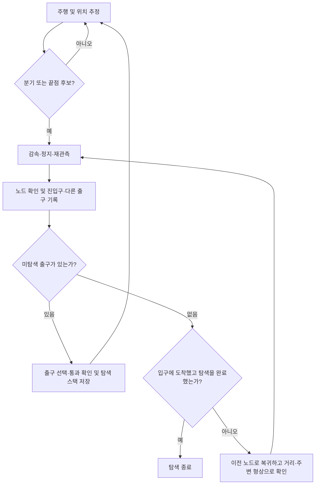

# 2026-09-27 자율 탐색·매핑·초음파 검사 설계

원본 PDF · **[26.09.27] 주보현 구체화 내용** (9쪽)

## 시제품 목표와 구성

미지의 배관망에서 분기를 발견하고, 각 출구를 순서대로 탐색한 뒤 입구로 복귀한다. 주행 중 연결 지도와 구간 길이를 갱신하고, 지정 지점에서는 정지해 초음파 탐상(UT)으로 큰 인공 홈의 유무와 위치를 기록한다. 관경은 차체의 T·Y 분기 진입과 복귀 시험 후 정하며, 미세 균열이나 정밀 깊이 추정은 확장 범위다.

| 장치 | 역할 |
| --- | --- |
| ESP32-S3 | 엔코더 계수, 속도 PID, 모터 PWM, 조향·탐촉자 서보, 리미트 스위치, 명령 시간초과 정지, 거리·IMU·엔코더 시각 기록 |
| Raspberry Pi 4급 또는 개발용 노트북 | 카메라·LED를 이용한 분기 인식, 노드 재인식, 지도 갱신, 깊이 우선 탐색(DFS), UT 파형 분석·위치 기록 |
| 독립 UT 수집부 | 탐촉자, 펄서, 송수신 보호, 수신 증폭·필터, 고속 ADC 또는 학교 오실로스코프. 파형과 측정 ID를 상위 컴퓨터에 전달한다. |

수평 배관에서는 짧은 차동 구동 차체를 먼저 시험한다. 이음부 턱을 넘기 어려우면 [Joey](https://www.frontiersin.org/journals/robotics-and-ai/articles/10.3389/frobt.2022.997415/full) 같은 바퀴-다리형을 비교하고, 경사나 중심 정렬이 중요하면 벽 밀착 바퀴형을 검토한다. 단순 차체가 분기에서 실패하면 능동 조향 또는 짧은 관절을 추가한다.

## 연결 지도와 분기 탐색

노드는 입구·분기점·막다른 곳으로, 간선은 배관 구간과 길이로 기록한다. 거리 센서, 엔코더, IMU로 구간 위치를 추정하고 카메라를 분기 재인식에 사용한다. 2D/3D 중심선은 누적 오차가 있는 시각화이며, 정밀 내벽 점군은 연결 지도 구현 이후 확장 항목이다.

## UT 측정과 지도 연결

정상·결함 시편의 재질, 벽 두께, 홈 깊이·길이·방향을 기록한다. 벽 두께의 25%, 50% 깊이는 시편 구분 예시다. 실제 깊이와 수직·사각 탐촉자 선택은 재질과 균열 방향에 맞춰 시험한다.

1. 로봇을 정지시켜 속도 0을 확인하고 탐촉자를 밀착한다.
2. 접촉 품질을 확인한 뒤 같은 조건에서 여러 차례 원파형을 수집한다.
3. DC 제거, 대역 필터, 포락선 처리를 적용한다. 기준 시편으로 정한 시간 구간에서 반사 진폭, 도착 시간, 배면 반사 변화를 비교한다.
4. 반복 측정 분포와 임계값으로 정상, 결함 후보, 접촉 불량·측정 실패를 나눈다. 재접촉 시험으로 압력이나 젤 부족에 따른 오경보를 확인한다.
5. 결과를 **수집 시점의 측정 ID와 구간 위치**에 연결하고, 탐촉자 복귀를 확인한 후 주행을 재개한다.

## 초음파 개발과 조달

| 접근 | 판단 |
| --- | --- |
| 부분 개발 + 학교 계측기 | 펄서·보호·수신 증폭·지그를 제작하고 학교 스코프로 원파형을 확보하는 저예산 우선안이다. 대역폭·샘플링률·트리거·입력 정격을 먼저 확인한다. |
| 공개 하드웨어 재현·구매 | [pic0rick](https://un0rick.cc/pic0rick)의 같은 리비전 회로·PCB·BOM·펌웨어를 맞춘다. 조립 보드는 USB/Python, Linux/ARM, 원파형 다운로드와 반복 수집을 검증한다. |
| 전부 신규 설계 | 고속 아날로그, PCB, ADC, 타이밍, 데이터 전송이 필요해 우선순위가 낮다. |
| 아날로그 포락선·비교기 | 데이터량을 줄일 수 있으나 원파형과 디버깅 정보가 줄어 원파형 검증 뒤 검토한다. |

당시 pic0rick의 $299는 과거 Tindie 표기다. [PCE-FD 20](https://www2.pce-instruments.com/us/measuring-instruments/test-meters/flaw-detector-pce-instruments-flaw-detector-pce-fd-20-det_5843009.htm)은 당시 US$6,898로 고가 비교 대상이었고 [EPOCH 650](https://ims.evidentscientific.com/en/products/flaw-detectors/epoch-650)은 학교 대여 후보였다. 수치만 표시하는 두께계는 원파형 확인에 제약이 있다. 학교 스코프로 파형을 확인한 뒤 원격 트리거·파형 다운로드가 가능한지 시험하고, 그 결과로 고속 ADC 탑재나 보드 구매를 결정한다.

## 잠정 예산 및 검증

보유 Pi 또는 노트북과 학교 계측기·3D 프린터 재사용을 전제로 **약 40만~77만 원**을 추정했다.

| 항목 | 만 원 |
| --- | ---: |
| 보유 상위 컴퓨터 | 0 |
| ESP32-S3 및 연결 | 1~3 |
| 주행·조향 | 5~9 |
| 거리·자세·영상 센서 | 5~10 |
| 몸체·접촉 지그 | 3~6 |
| 배관망·교체형 시편 | 3~6 |
| 전원·배선 | 3~5 |
| UT 부분 개발 | 15~30 |
| 배송·소모품·재제작 | 5~8 |

구매형으로 비교할 때는 UT 부분 개발비를 보드·탐촉자·웨지·케이블의 도착가로 대체한다. 새 Pi와 계측기 구매, 고가 가공은 위 범위에서 제외한 항목이다.

| 검증 단계 | 기록할 결과 |
| --- | --- |
| 1. 기구 | 예정 하중에서 직선·엘보·T·Y 진입 및 복귀 성공률, 걸림, 미끄러짐 |
| 2. 센서·주행 | 벽·굴곡·분기·끝점 오분류율, 측정 실패율, 정지거리 |
| 3. 미지의 망 | 분기 누락, 오진입, 노드 오합침, 실시간 지도 및 입구 복귀율 |
| 4. UT 단독 | 정상·큰 홈의 반복 파형, 검출률, 오경보율, 측정 실패율 |
| 5. 통합 | 홈의 실제 위치 대비 구간 거리 오차, 검사 누락, 자율 복귀, 원파형과 지도 기록의 대응 |
