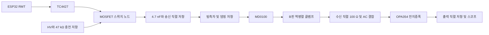

# 2026-10-23 만능기판 펄서·리시버 설계

원본 PDF · **[26.10.23] New 만능기판 구조(펄서 리펄서)** (10쪽)

## 벤치 회로 구성

5 MHz 단일 소자 탐촉자를 위한 커패시터 결합 음펄서와 보호·수신 증폭 회로다. ESP32의 RMT가 짧은 트리거를 만들고 별도 BNC로 스코프 타이밍을 제공한다. 외부 12 V는 TC4427과 HV 승압부, 수신용 5 V 전원에 공급한다. HV에서 47 kΩ을 거쳐 MOSFET 드레인 노드를 충전하고, MOSFET이 도통할 때 생기는 급격한 전압 변화를 4.7 nF 커패시터와 직렬 저항을 통해 탐촉자에 전달한다.

아래 신호 경로는 원문의 2차 검토를 반영했다.

## 초기 부품표

금액은 원문에 표시된 당시 견적이다. **2차 검토에서 교체한 부품과 값은 다음 절을 기준으로 구분한다.**

| 역할 | 원안의 부품·수량 | 당시 금액 |
| --- | --- | ---: |
| 트리거·게이트 구동 | ESP32 DevKitC, TC4427CPA 각 1개 | 8,690원 / 3,080원 |
| 송신 스위치·승압 | IRF640N, LM2587 모듈 각 1개 | 770원 / 15,400원 |
| 펄스 커패시터 | KEMET R76MD1470SE30J, 4.7 nF / 400 V PP 1개 | 1,450원 (VAT 미확인) |
| 충전·방전 | 47 kΩ / 2 W 3개. 1개는 충전용, 2개 직렬은 HV 방전용 | 개당 620원 (VAT 미확인) |
| 송신 직렬·댐핑 | 100 Ω / 2 W 각 1개 | 개당 620원 (VAT 미확인) |
| 수신 보호 | MD0100N8-G 1개, 1N4148W-7-F 사용 2개 | 2,470원 (VAT 미확인) / 10개 1,320원 |
| 수신 증폭·AC 결합 | OPA354AIDBVT, 1 nF / 50 V C0G 각 1개 | 4,994원 / 270원 (C0G VAT 미확인) |
| 수신용 5 V | LM2596 모듈, 10 Ω 필터와 디커플링 | 모듈 2,640원 |
| 소신호 저항 | NT-KIT-R015 1세트. 10 Ω, 100 Ω, 1 kΩ, 10 kΩ 사용 | 1,320원 |
| 전원·피드백 커패시터 | 100 nF 사용 6개, 10 µF 사용 3개 | 종류별 10개 330원 |
| 외부 연결·기판 | BNC-RB 3개, FA263, G301, GA3 100 × 100 mm, KF301-5.0-2P | 10,230원 / 4,400원 / 4,730원 / 6,380원 / 418원 |
| 선택 | 5 mm 구리 테이프, 전원용 AWG22 적·흑 | 4,620원 / 색상별 4,180원 |

원안의 저항 배치는 게이트 직렬 10 Ω, 게이트·트리거 풀다운 각각 10 kΩ, 트리거 입력 직렬 100 Ω, 스코프 타이밍 출력 직렬 1 kΩ이다. OPA354 초기 피드백은 출력에서 반전 입력으로 1 kΩ, 반전 입력에서 GND로 100 Ω과 100 nF 직렬이었다.

## 2차 검토

| 항목 | 원문의 수정 제안 |
| --- | --- |
| MD0100 보호 | B핀 바로 옆에서 GND로 1N4148 두 개를 역병렬 연결하고 수신 직렬 100 Ω은 클램프 뒤에 배치한다. COM 2번 핀을 연결하지 않으며 탭은 패키지 도면으로 확인한다. |
| OPA354 바이어스 | 1 kΩ 두 개로 만든 2.5 V 분압점을 10 µF와 100 nF로 바이패스한다. 분압점에서 별도 1 kΩ을 거쳐 비반전 입력으로 연결하고, 에코의 1 nF AC 결합은 입력 쪽에 둔다. |
| 피드백과 회복 | 100 Ω에 직렬인 100 nF를 1 nF C0G로 바꾼다. 원문 계산은 코너 약 1.6 MHz, 시정수 0.1 µs, 5 MHz 이득 약 10.5배다. 송신 직후 1~2 µs 블랭킹은 시험 후 조정할 값이다. |
| MOSFET과 게이트 구동 | IRF640N 대신 게이트 전하가 더 작은 IRF620 또는 IRF610을 비교한다. TC4427 한 채널을 사용하고 VDD 가까이에 1 µF 세라믹을 추가한다. 출력 펄스 폭은 스코프로 확인한다. |
| 탐촉자 저항 | 소켓을 써서 댐핑 100·220·470 Ω과 송신 직렬 0·10·47·100 Ω을 비교한다. 에코가 약하면 HV 조정 전에 직렬 저항의 영향을 확인한다. |
| 수신 5 V | 스위칭 잡음을 줄이기 위해 LM2596 대신 78L05/7805 LDO를 검토한다. OPA354의 피드백과 디커플링은 IC 가까이에 둔다. |
| 스코프 연결 | 초기 기준은 1 MΩ 입력과 DC 커플링이다. 출력 직렬 100 Ω을 기본 후보로 유지하고, 50 Ω 동축과의 소스 정합에는 47~51 Ω을 검토한다. |
| 승압·반복률 | LM2587의 모듈 출력 정격을 확인하고, 2차 검토에서는 링잉 여유를 위해 50 V 이하를 제안했다. 47 kΩ × 4.7 nF로 계산한 충전 시정수는 약 0.22 ms이며, 500 Hz를 시험 후보로 제시했다. |
| 방전·배선 | 출력 커패시터 정격과 실제 방전 시간을 확인한다. 원문은 절연형 12 V 전원, HV용 10× 프로브, 회로 GND에만 스코프 접지 연결을 기록했다. 송신 전류 루프를 짧게 하고 승압부와 수신부를 떨어뜨린다. |

조달 메모에는 리드형 1N4148·100 nF·1 nF C0G 사용, MD0100 및 OPA354 예비품 확보, 디바이스마트 2 W 저항(47 kΩ no. 1176, 100 Ω no. 1220)과 GA3(no. 24853)가 포함돼 있다. 원문은 4.7 nF KEMET 국내 상품이 판매 보류라고 기록했고 엘레파츠(no. 6146775)를 대안으로 적었다. MD0100은 엘레파츠(no. 19180387) 또는 해외 연동 상품이 후보였다. OPA354 약 2주와 TC4427 약 4~5일은 당시 표시 납기다.

## VG1 시편 시험

PVC 음속을 약 2,395 m/s로 두면, 벽 두께 6.6 mm에서 배면 왕복 에코는 약 **5.5 µs**로 예상된다. 문헌의 5 MHz 감쇠 예시(약 1.2 dB/mm)는 왕복 13.2 mm에서 약 16 dB에 해당한다. 실제 감쇠와 진폭은 VG1 시편 및 물·젤 커플링 조건에서 확인할 항목이다.

1. 탐촉자 대신 50 Ω 시험 부하에서 10× 프로브로 송신 폭과 전압을 확인한다. 원문 목표 폭은 약 100 ns다.
2. MD0100 B핀에서 잔류 전압이 ±1 V 이내인지 확인하고 수신 회복 시간을 기록한다.
3. LCR로 탐촉자 정전용량을 측정하고 VG1 평판에서 커플런트를 사용해 에코를 확인한다. 직렬·댐핑 저항을 바꾸며 에코 크기와 링잉을 비교한다.
4. 약 5.5 µs의 배면 에코를 찾는다. 얇은 VG2의 경우 에코가 링다운에 겹치는지 확인한다. 연속 배면 에코가 두 번 보이면 진폭의 dB 차이로 감쇠를 추정한다.
5. 고속 ADC 파형을 검출 알고리즘으로 처리한 뒤 벤치 결과를 확인하고 PCB 전환을 검토한다.

## 디지털 수집과 로봇 탑재

- 원문이 인용한 균열 검출 알고리즘은 3~7 MHz 대역통과와 포락선 처리를 사용한다. 문서는 이를 위해 14 MS/s를 샘플링 하한으로 보고, 실용 후보를 25~50 MS/s로 제안했다.
- AD9226 12비트 모듈과 Raspberry Pi Pico 2의 PIO로 파형·트리거를 동기화하고, USB로 Pi 또는 노트북에 전송하는 방안이다. 국내 조달은 확인 항목이다. 후속으로 AD8331 가변 이득 수신부를 검토한다. [hsdaoh-rp2350](https://github.com/steve-m/hsdaoh-rp2350), [Wicap](https://iosoft.blog/wicap)
- 원문이 지적한 배면 게이트 2~4 µs는 VG1의 약 5.5 µs에 맞춰 조정한다. 절대 진폭 감소 대신 앞면 에코 대비 비율을 비교하고, 기준 에코가 없으면 측정 무효로 기록하는 방안이다.
- 로봇 버전은 SMD 송신부, 소형 승압기와 LDO, 짧은 50 Ω 동축(0.5 m 이하) 및 탐촉자 근처 댐핑을 검토한다. 정지 검사 중 모터와 HV 승압을 끄는 방안은 펄스에 필요한 전압 유지와 함께 검증할 항목이다.

원문 참고 자료 · [MD0100](https://cdn.components.ru/media/PDF/1095896.pdf), [TC4427](https://ww1.microchip.com/downloads/en/DeviceDoc/20001422G.pdf), [OPA354](https://www.ti.com/lit/ds/symlink/opa354.pdf), [IRF620](https://www.vishay.com/docs/91027/irf620.pdf), [IRF610](https://www.vishay.com/docs/91023/irf610.pdf), [LM2587](https://www.ti.com/product/lm2587), [초음파 감쇠 자료](https://www.ndt.net/article/ndt-review/papers/applsci-10-02230-v5.pdf), [PVC 음속](https://www.olympus-ims.com/en/ndt-tutorials/thickness-gage/appendices-velocities/), [ESP32 ADC FAQ](https://docs.espressif.com/projects/esp-faq/en/latest/software-framework/peripherals/adc.html), [AD8331](https://www.analog.com/en/products/ad8331.html), [un0rick](https://un0rick.cc/un0rick)
