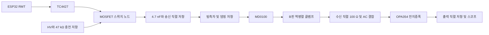

# 2026-10-23 만능기판 펄서·리시버 설계

원본 PDF · **[26.10.23] New 만능기판 구조(펄서 리펄서)** (10쪽)

## 벤치 회로 구성

5 MHz 단일 소자 탐촉자를 위한 커패시터 결합 음펄서와 보호·수신 증폭 회로다. ESP32의 RMT가 짧은 트리거를 만들고 별도 BNC로 스코프 타이밍을 제공한다. 외부 12 V는 TC4427과 HV 승압부, 수신용 5 V 전원에 공급한다. HV에서 47 kΩ을 거쳐 MOSFET 드레인 노드를 충전하고, MOSFET이 도통할 때 생기는 급격한 전압 변화를 4.7 nF 커패시터와 직렬 저항을 통해 탐촉자에 전달한다.

아래 신호 경로는 원문의 2차 검토를 반영했다.

## 초기 부품표

금액은 원문에 표시된 당시 견적이다. **2차 검토에서 교체한 부품과 값은 다음 절을 기준으로 구분한다.**

| 역할 | 원안의 부품·수량 | 당시 금액 |
| --- | --- | ---: |
| 트리거·게이트 구동 | ESP32 DevKitC, TC4427CPA 각 1개 | 8,690원 / 3,080원 |
| 송신 스위치·승압 | IRF640N, LM2587 모듈 각 1개 | 770원 / 15,400원 |
| 펄스 커패시터 | KEMET R76MD1470SE30J, 4.7 nF / 400 V PP 1개 | 1,450원 (VAT 미확인) |
| 충전·방전 | 47 kΩ / 2 W 3개. 1개는 충전용, 2개 직렬은 HV 방전용 | 개당 620원 (VAT 미확인) |
| 송신 직렬·댐핑 | 100 Ω / 2 W 각 1개 | 개당 620원 (VAT 미확인) |
| 수신 보호 | MD0100N8-G 1개, 1N4148W-7-F 사용 2개 | 2,470원 (VAT 미확인) / 10개 1,320원 |
| 수신 증폭·AC 결합 | OPA354AIDBVT, 1 nF / 50 V C0G 각 1개 | 4,994원 / 270원 (C0G VAT 미확인) |
| 수신용 5 V | LM2596 모듈, 10 Ω 필터와 디커플링 | 모듈 2,640원 |
| 소신호 저항 | NT-KIT-R015 1세트. 10 Ω, 100 Ω, 1 kΩ, 10 kΩ 사용 | 1,320원 |
| 전원·피드백 커패시터 | 100 nF 사용 6개, 10 µF 사용 3개 | 종류별 10개 330원 |
| 외부 연결·기판 | BNC-RB 3개, FA263, G301, GA3 100 × 100 mm, KF301-5.0-2P | 10,230원 / 4,400원 / 4,730원 / 6,380원 / 418원 |
| 선택 | 5 mm 구리 테이프, 전원용 AWG22 적·흑 | 4,620원 / 색상별 4,180원 |

원안의 저항 배치는 게이트 직렬 10 Ω, 게이트·트리거 풀다운 각각 10 kΩ, 트리거 입력 직렬 100 Ω, 스코프 타이밍 출력 직렬 1 kΩ이다. OPA354 초기 피드백은 출력에서 반전 입력으로 1 kΩ, 반전 입력에서 GND로 100 Ω과 100 nF 직렬이었다.

## 2차 검토

### 변경 부품표

원본 PDF 6~8쪽의 민수 의견을 반영한 **1차 벤치 시험용 변경분**이다. 수량은 기판 1대 기준이며, 예비품은 별도로 표시했다.

| 구분 | 부품·위치 | 기존 | 변경안 및 수량 |
| --- | --- | --- | --- |
| 교체 | 송신 MOSFET | IRF640N | **IRF620 1개**를 우선 후보로 하고, **IRF610 1개**를 대안으로 둔다. 디바이스마트 상품번호는 각각 31230, 31229다. |
| 추가 | TC4427 전원 디커플링 | 기존 100 nF·10 µF | 기존 디커플링에 **1 µF 세라믹 1개**를 추가해 VDD 근처에 둔다. TC4427은 한 채널을 사용한다. |
| 교체·이동 | 수신 클램프 | SMD 1N4148W-7-F 2개, 직렬 저항 뒤 | **리드형 1N4148 2개**를 MD0100의 B핀과 GND 사이에 역병렬로 배치한다. 디바이스마트 상품번호 25. |
| 이동 | 수신 직렬 저항 | 100 Ω 1개, MD0100과 클램프 사이 | **100 Ω 1개**를 클램프 노드 뒤, AC 결합 커패시터 앞에 둔다. |
| 추가 | OPA354 2.5 V 바이어스 | 1 kΩ 2개로 만든 분압점이 비반전 입력과 직결 | 분압점에서 GND로 **10 µF 1개와 100 nF 1개**를 병렬로 연결한다. 분압점에서 **1 kΩ 1개**를 거쳐 비반전 입력으로 연결하고, 수신 AC 결합 커패시터는 비반전 입력 쪽에 둔다. |
| 교체 | OPA354 피드백 커패시터 | 100 Ω과 직렬인 100 nF | **1 nF C0G 1개**로 교체한다. 수신 AC 결합용 1 nF와 별도이므로 **리드형 1 nF C0G는 총 2개**가 필요하다. |
| 교체 | 만능기판용 소형 커패시터 | 0603 100 nF, 0805 1 nF C0G | 리드형으로 바꾼다. 원문 조달 후보는 엘레파츠 **FG18X7R1H104KNT06**(100 nF, 7703879), **FG28C0G1H102JNT06**(1 nF C0G, 7704166)이다. 100 nF 총수량은 5 V 전원부 배치를 확정한 뒤 산정한다. |
| 교체·추가 | 송신 직렬·탐촉자 댐핑 저항 | 각각 100 Ω 고정 | **교체용 소켓 2자리**를 둔다. 송신 직렬은 **0 Ω 점퍼 / 10 Ω / 47 Ω / 100 Ω**, 댐핑은 **100 Ω / 220 Ω / 470 Ω**을 각각 비교한다. 각 값은 시험용 1개씩이며, 두 위치에서 100 Ω을 동시에 시험하려면 2개가 필요하다. |
| 교체 | 수신부 5 V 전원 | LM2596 5 V 모듈과 후단 필터 | **78L05 또는 7805 1개**로 교체한다. 12 V에서 수신용 5 V를 만들며, 입·출력 커패시터는 선택한 제조사·품번의 데이터시트에 맞춘다. |
| 선택 | OPA354 출력 직렬 저항 | 100 Ω 1개 | 스코프 1 MΩ 입력으로 보는 초기 시험에서는 **100 Ω 1개**를 사용한다. 50 Ω 동축 소스 정합을 시험할 때 **47~51 Ω 1개**를 비교한다. |
| 추가·사양 확인 | LM2587 HV 모듈 출력 필터 | 승압 모듈 직접 출력 | 원문 제안은 **RC 또는 LC 필터 1세트**를 추가하는 것이다. 부품값은 미정이다. 모듈 출력 및 커패시터 정격을 확인하고 원문의 **50 V 이하**는 벤치 시험 상한 제안으로 기록한다. |
| 예비 | MD0100N8-G, OPA354AIDBVT | 실장 각 1개 | **MD0100 2~3개, OPA354 2개를 추가**한다. 실장분을 포함하면 각각 **3~4개, 3개**다. |

### 배치·시험 확인

- MD0100N8-G의 **COM(2번 핀)은 연결하지 않는다**. G301에서 탭이 COM과 이어지는지 패키지 도면과 기판 패턴으로 확인한다. B핀에 붙인 역병렬 클램프에서 수신 직렬 100 Ω과 AC 결합 커패시터로 이어진다. [Microchip MD0100 데이터시트](https://www.microchip.com/content/dam/mchp/documents/OTH/ProductDocuments/DataSheets/MD0100-Single-and-Dual-ChannelHigh-Voltage-Protection-TR-Switch-Data-Sheet-20005738A.pdf)
- OPA354의 100 Ω–1 nF 피드백 가지를 적용하고 이득 조정용 소켓을 유지한다. 송신 직후 **1~2 µs 블랭킹**은 원문 제안값이며, 실제 수신 회복 시간을 스코프로 확인해 조정한다.
- LM2587은 수신부에서 떨어뜨려 배치한다. 47 kΩ × 4.7 nF의 계산 시정수는 약 0.22 ms이며 원문은 **500 Hz**를 시험 후보로 제안했다. HV 블리더 47 kΩ 두 개는 유지하고 실제 방전 시간을 확인한다. 원문은 절연형 12 V 전원과 HV용 10× 프로브를 사용하며, 스코프 접지 클립을 회로 GND에 연결하도록 기록했다.
- 조달처 변경은 PDF 당시 조사 기준이다. **4.7 nF / 400 V PP 필름**은 엘레파츠 6146775, **MD0100N8-G**는 엘레파츠 19180387, **47 kΩ / 2 W**와 **100 Ω / 2 W**는 디바이스마트 1176·1220, **GA3 만능기판**은 디바이스마트 24853이 후속 후보다. LM2587 대체 모듈(디바이스마트 15961147)은 출력 사양 확인 후 선택한다.

## VG1 시편 시험

PVC 음속을 약 2,395 m/s로 두면, 벽 두께 6.6 mm에서 배면 왕복 에코는 약 **5.5 µs**로 예상된다. 문헌의 5 MHz 감쇠 예시(약 1.2 dB/mm)는 왕복 13.2 mm에서 약 16 dB에 해당한다. 실제 감쇠와 진폭은 VG1 시편 및 물·젤 커플링 조건에서 확인할 항목이다.

1. 탐촉자 대신 50 Ω 시험 부하에서 10× 프로브로 송신 폭과 전압을 확인한다. 원문 목표 폭은 약 100 ns다.
2. MD0100 B핀에서 잔류 전압이 ±1 V 이내인지 확인하고 수신 회복 시간을 기록한다.
3. LCR로 탐촉자 정전용량을 측정하고 VG1 평판에서 커플런트를 사용해 에코를 확인한다. 직렬·댐핑 저항을 바꾸며 에코 크기와 링잉을 비교한다.
4. 약 5.5 µs의 배면 에코를 찾는다. 얇은 VG2의 경우 에코가 링다운에 겹치는지 확인한다. 연속 배면 에코가 두 번 보이면 진폭의 dB 차이로 감쇠를 추정한다.
5. 고속 ADC 파형을 검출 알고리즘으로 처리한 뒤 벤치 결과를 확인하고 PCB 전환을 검토한다.

## 디지털 수집과 로봇 탑재

- 원문이 인용한 균열 검출 알고리즘은 3~7 MHz 대역통과와 포락선 처리를 사용한다. 문서는 이를 위해 14 MS/s를 샘플링 하한으로 보고, 실용 후보를 25~50 MS/s로 제안했다.
- AD9226 12비트 모듈과 Raspberry Pi Pico 2의 PIO로 파형·트리거를 동기화하고, USB로 Pi 또는 노트북에 전송하는 방안이다. 국내 조달은 확인 항목이다. 후속으로 AD8331 가변 이득 수신부를 검토한다. [hsdaoh-rp2350](https://github.com/steve-m/hsdaoh-rp2350), [Wicap](https://iosoft.blog/wicap)
- 원문이 지적한 배면 게이트 2~4 µs는 VG1의 약 5.5 µs에 맞춰 조정한다. 절대 진폭 감소 대신 앞면 에코 대비 비율을 비교하고, 기준 에코가 없으면 측정 무효로 기록하는 방안이다.
- 로봇 버전은 SMD 송신부, 소형 승압기와 LDO, 짧은 50 Ω 동축(0.5 m 이하) 및 탐촉자 근처 댐핑을 검토한다. 정지 검사 중 모터와 HV 승압을 끄는 방안은 펄스에 필요한 전압 유지와 함께 검증할 항목이다.

원문 참고 자료 · [MD0100](https://cdn.components.ru/media/PDF/1095896.pdf), [TC4427](https://ww1.microchip.com/downloads/en/DeviceDoc/20001422G.pdf), [OPA354](https://www.ti.com/lit/ds/symlink/opa354.pdf), [IRF620](https://www.vishay.com/docs/91027/irf620.pdf), [IRF610](https://www.vishay.com/docs/91023/irf610.pdf), [LM2587](https://www.ti.com/product/lm2587), [초음파 감쇠 자료](https://www.ndt.net/article/ndt-review/papers/applsci-10-02230-v5.pdf), [PVC 음속](https://www.olympus-ims.com/en/ndt-tutorials/thickness-gage/appendices-velocities/), [ESP32 ADC FAQ](https://docs.espressif.com/projects/esp-faq/en/latest/software-framework/peripherals/adc.html), [AD8331](https://www.analog.com/en/products/ad8331.html), [un0rick](https://un0rick.cc/un0rick)
